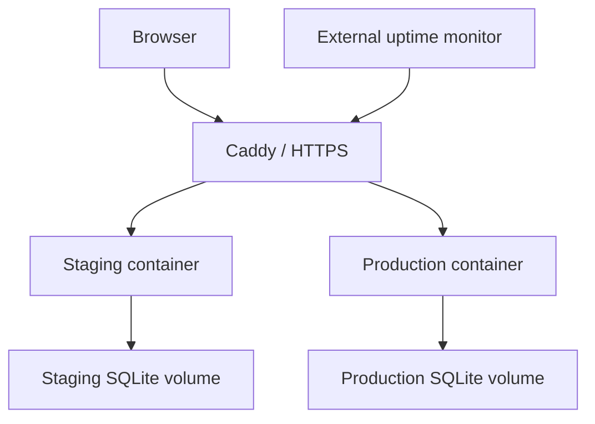
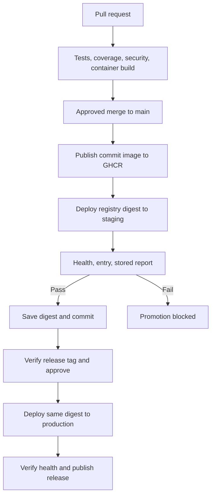

# StudySpot deployment and release

Each container serves the catalog, forms and live endpoints. SQLite is
embedded in the Flask process and persists on a named volume. Staging and
production are configured as different Compose projects. The Sites pilot is
a separate runtime.

A transaction runs the additive schema and catalog setup when a container starts.
The staging sample space is initialized within the same transaction. Its smoke
workflow signs in at the staging web gateway, opens the catalog, submits an
observation to the sample space and reads it back in a second session. Production
verification is read-only.
