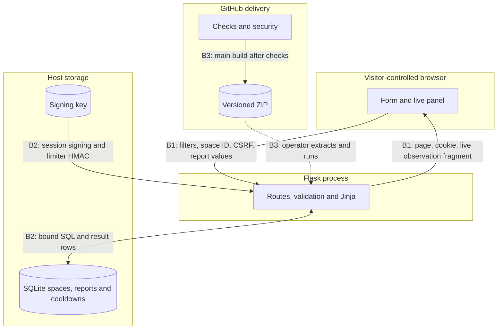

# StudySpot Sprint 4 security audit

Hai Long Ha · Group 6 · November 11, 2026

Scope: GitHub main at 343aebb and the local Sprint 4 candidate. The app binds to
loopback by default. The earlier baseline used fictional spaces. The new campus
catalog has six verified Vanderbilt locations and starts with an empty report
database. The Flask runtime uses public reports, signed cookies and local SQLite.
Account PR #5 remains a separate, open change. The hosted pilot has a separate
shared report database and its own security controls.

## Data flow and trust boundaries

| ID | Boundary | STRIDE | Asset and threat | Control / finding |
|---|---|---|---|---|
| T1 | B1 | Spoofing | A cross-site form tries to submit as a visitor. | Session CSRF token and SameSite. Malformed token handling fixed in SEC-04. |
| T2 | B1 | Tampering | One source repeatedly replaces the newest displayed report. | Field allow-lists and atomic 60-second cooldown. SEC-01. |
| T3 | B1 | Repudiation | Anonymous reporter disputes an inaccurate observation. | Time and row ID establish that a report exists. Reporter identity is unavailable. Accepted risk owned by Hai Long Ha. |
| T4 | B2 | Information disclosure | Another OS user reads signing key or database. | Restrict default POSIX instance directory and key. Windows relies on ACLs. SEC-02. |
| T5 | B1/B2 | Denial of service | Concurrent submissions flood SQLite or bypass a non-atomic limit. | Body cap, bounded recent-report query, atomic cooldown. Distributed traffic and history retention remain gaps. SEC-01. |
| T6 | B3 | Elevation of privilege | A moved action tag changes code run by GitHub Actions. | Pin actions to commit IDs. SEC-03. |
| T7 | B1 | Tampering | Crafted filter input alters SQL or becomes HTML. | Bound parameters, fixed SQL clauses and Jinja escaping. |
| T8 | B1 | Information disclosure | A cached response varies by session and is served to the wrong user. | Flask upgrade. Public live fragment carries no session data and uses no-store. SEC-05. |
| T9 | B3 | Elevation of privilege | A local OS user exploits pytest temporary directories on a shared runner. | Upgrade test dependency and audit CI lock. SEC-06. |
| T10 | B1 | Tampering | A frame or wrongly interpreted content can mislead visitors. | Frame restrictions and nosniff in CSP/response headers. SEC-07. |

## Findings

Fixes below are verified locally on the Sprint 4 branch. GitHub fix PR and remote
checks are pending. Earlier ICA15 items F01, F02 and F03 correspond to SEC-01,
SEC-02 and SEC-03 here. Artifact provenance remains a follow-up to SEC-03.

| ID | Title | Appendix A | STRIDE | Location | Severity | How found / proof | Regression / status |
|---|---|---|---|---|---|---|---|
| SEC-01 | Repeated report writes | A04 | Tampering, DoS | POST /spaces/:id/reports | Medium | Two valid reports from the same source and space were both accepted on the baseline. | test_cooldown_boundary_and_scope, test_concurrent_report_writes_cannot_bypass_cooldown. Fixed locally. |
| SEC-02 | Local signing key readable through permissive modes | A02 | Information disclosure | app.py, instance/session.key | Medium | Existing 0755 directory and 0644 key stayed unchanged on baseline. | test_existing_instance_storage_is_private, test_environment_key_skips_local_key_creation. Fixed locally on POSIX. |
| SEC-03 | Movable action refs | A08 | Elevation of privilege | .github/workflows/ci.yml | Medium | Baseline actions pointed to major-version tags. | test_workflow_action_references_are_immutable. Fixed locally. |
| SEC-04 | Non-ASCII CSRF value produces a server error | A03 | DoS | POST /spaces/:id/reports | Low | A non-ASCII value reaches str compare_digest and raises TypeError on baseline. | test_non_ascii_csrf_token_returns_400. Fixed locally. |
| SEC-05 | Flask misses Vary: Cookie on some membership reads | A06 | Information disclosure | Runtime and CI locks | Low | pip-audit CVE-2026-27205. A synthetic membership-only route lacked Vary on Flask 3.1.2. | test_flask_session_membership_response_varies_on_cookie. Fixed locally in 3.1.3. |
| SEC-06 | pytest temporary directory handling | A06 | Elevation of privilege, DoS | Development and CI locks | Medium | pip-audit CVE-2025-71176 on pytest 8.4.2. Relevant to local/shared Unix tooling. | Dependency CI gate red on old lock, green on pytest 9.0.3. Fixed locally. |
| SEC-07 | Missing browser security headers | A05 | Tampering | Flask response headers | Low | Baseline detail and live responses had no CSP or nosniff. | test_app_and_live_feed_send_browser_security_headers. Fixed locally. |

## Scans and triage

- Bandit 1.9.4 on app.py, domain.py and scripts/build_artifact.py. One Medium
  B608 is a false positive for injection because the code selects fixed SQL
  clauses and binds every user value. One Low B101 is a false positive for a
  validation bypass because invalid values raise ValueError before the assert,
  including under optimized Python. Zero High. No suppressions.
- pip-audit 2.10.1 on both locks. Baseline returned two runtime rows and four CI
  rows. The scanner repeated advisory IDs across feeds and Flask was in both
  locks. Deduplicated result: two true-positive vulnerable package versions,
  one Low and one Moderate. After upgrading Flask and pytest, both scans passed.
- gitleaks 8.30.0 with --redact and git log --all. No matches in the local clone's
  fetched branch histories. No scan was performed against a third-party system.
- High Bandit findings, any published dependency advisory and any secret match
  exit nonzero in CI. The 70% combined/overall-branch gates and 85% app/domain
  branch gates are retained. The example branch-protection JSON includes both
  job names. Applying that policy and obtaining remote runs remain pending.

## OWASP Appendix A checks

| Check | Reviewed evidence | Result |
|---|---|---|
| A01 Broken Access Control | Enumerated GET detail/live and POST report routes. Probed missing IDs and cross-space isolation with local fixtures. | Pass for public routes. Owner/admin IDOR is N/A for this build because it has no private or admin resources. |
| A02 Cryptographic Failures | Inspected random key, cookie flags, generated POSIX modes and environment-key behavior. | SEC-02 fixed locally. HTTPS staging and Windows ACL behavior remain unverified. |
| A03 Injection | Inspected fixed query fragments and bound SQL, Jinja escaping, and malformed form input. | Bound SQL/escaping pass. SEC-04 fixed locally. |
| A04 Insecure Design | Verified 16 KiB body cap, five visible history rows and write concurrency. | SEC-01 fixed locally. Anonymous truthfulness, distributed abuse and observation retention remain limitations. |
| A05 Security Misconfiguration | Debug disabled, loopback binding, no wildcard CORS, no default accounts, CSP and nosniff. | SEC-07 fixed locally. Production deployment settings remain unverified. |
| A06 Vulnerable Components | Audited runtime and CI lockfiles before/after. | SEC-05 and SEC-06 fixed locally. |
| A07 Identification & Authentication | Main and candidate were checked for login, logout and password-reset routes. | N/A for this local build. PR #5 is separate. |
| A08 Software & Data Integrity | Reviewed read-only CI permissions, pinned actions, main-only artifact and dependency locks. | SEC-03 fixed locally. Independent artifact provenance and GitHub rules verification pending. |
| A09 Logging & Monitoring | Checked malformed report and cooldown outcomes. Cookie and token values are excluded from intentional logging. | Accepted risk: prototype has no structured abuse alerts. Owner: Hai Long Ha. |
| A10 SSRF | Traced all requests initiated from the server. | N/A. No route fetches a user-supplied URL. |

## AI-generated code audit

Two high-risk modules were inspected from top to bottom. In app.py, the startup
path originally relied on default local permissions and created a local key even
with an environment key. The route checks rejected missing/wrong CSRF values
but missed non-ASCII values. The read path needed per-space and no-cache
tests when polling was added. The write path needed transactional concurrency
coverage. A preventative prompt would specify private POSIX permissions,
environment-key precedence, malformed Unicode tokens, per-space isolation and
a concurrent retry test using separate SQLite connections.

In domain.py, search parsing restricts allowed choices, query construction binds
values, and the validation exception precedes the type-narrowing assert.
Report age is server-derived and becomes stale at 60 minutes. Corrupt timestamps
inserted outside the application can still break the read path. A preventative
prompt would require tests of crafted search values and read behavior for
malformed stored rows. No LLM calls are present in the product.

## ADR-04 · Keep cooldown and report insertion in one transaction

A report goes live as soon as its SQLite transaction commits. Reserve a cooldown
for the HMAC of direct peer address plus space and insert the observation in
the same transaction. This prevents simultaneous POSTs from committing two
reports inside the same 60-second interval. An expired limiter entry is purged
on a later accepted submission. No raw IP is written to the limiter table.

An in-process counter would reset at restart and split across workers. A raw IP
column would retain more identifying information than needed. The chosen peer
address is shared by users behind a NAT and could be the reverse proxy address
if the deployment changes. It is a limited local control and does not fulfill
the originally planned account-specific story US19.

## References

- [Flask advisory CVE-2026-27205](https://github.com/pallets/flask/security/advisories/GHSA-68rp-wp8r-4726)
- [pytest advisory CVE-2025-71176](https://github.com/advisories/GHSA-6w46-j5rx-g56g)
- [StudySpot main baseline](https://github.com/hailong0410/StudySpot/tree/343aebb42e919057ca6552e68872086ce08f8de7)

## Hosted pilot boundary

The browser uses HTTPS to reach a Worker, which reads and writes D1 using
bound parameters. The public read endpoint excludes source keys, returns
at most five observations and sets no-store. The POST endpoint checks
Origin, enforces a bounded form body, validates choices and restricts
repeated writes atomically. HMAC signing material is stored in the hosting
environment. Reports are visible for seven days. Tests run in isolated data
and no reports are seeded on campus locations.
